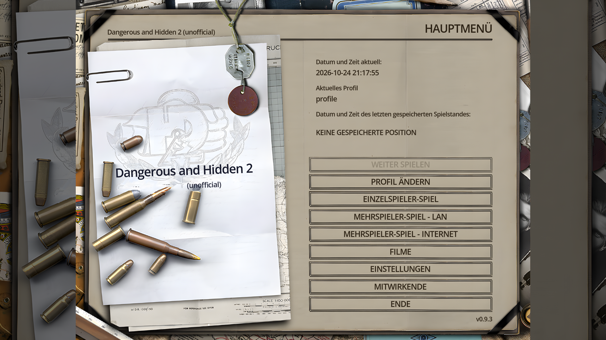
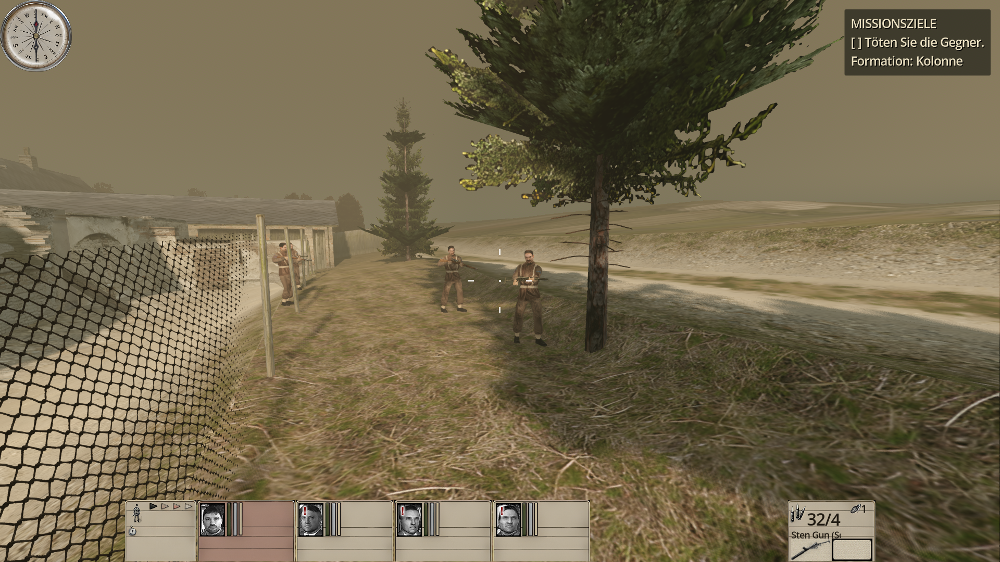
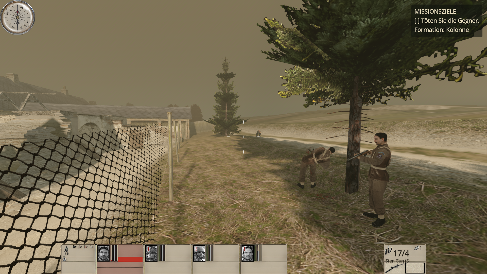
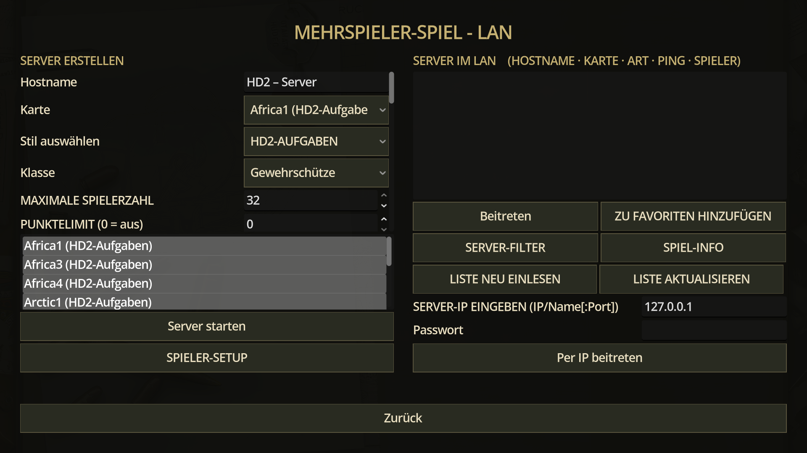

# Dangerous and Hidden 2 

**Ein Fanprojekt mit dem Versuch, das großartige alte *Hidden & Dangerous 2* in einer modernen Engine neu umzusetzen.**

Kein offizielles Spiel des Herstellers, keine kommerzielle Absicht – einfach nur die Liebe zum Spiel ❤️

> 🛒 **Kauft das Original!** *Hidden & Dangerous 2* gibt es z. B. bei [GOG](https://www.gog.com/) – ohne eine
> eigene Original-Installation funktioniert dieses Projekt auch gar nicht.
>
**Hinweis: Die Entwicklung fand rein mit dem Orignal Spiel (CD) statt, daher nicht mit der Version Hidden & Dangerous 2: Courage Under Fire und auch ohne das Addon Sabre Squadron**

---

## Worum geht es?

*Dangerous and Hidden 2* ist eine **Neuentwicklung mit [Godot 4](https://godotengine.org/)** (GDScript) –
ein taktischer WW2-Squad-Shooter, der sich spielerisch sehr eng am originalen *Hidden & Dangerous 2* orientiert:
SAS-Trupp, Kampagnen in Arktis, Nordafrika, Norwegen, Burma, Alpen, Normandie und Tschechien, Schleichen,
Tarnung, Fahrzeuge, Original-Missionsabläufe.

- **Nah am Original:** Leveldesign, Missionsziele, Missionsskripte, Dialoge, Musik und Klänge sollen sich so
  anfühlen wie damals. Die Original-Missionsskripte wurden von einem eigenen neuen Compiler/Interpreter ausgeführt.
- **Quality of Life:** wo es dem Spielgefühl hilft, ist die Bedienung moderner (siehe unten).
- **Neu geschrieben:** Engine-Code, KI, Physik, Oberfläche und Werkzeuge sind eigene Entwicklungen.
  Es wird kein Code des Originals verwendet.
- Texturen und Sounds sind aus dem Original und müssen manuel exportiert und Importiert werden
- LAN Modus mit BOTs ist implementiert

## Screenshots (v0.9.3)

| Hauptmenü | Im Einsatz |
|---|---|
|  |  |
| **Gefecht** | **LAN-Mehrspieler** |
|  |  |

## Keine Originaldaten im Repository

Dieses Repository enthält **keine Dateien des Originalspiels** – keine Modelle, Texturen, Klänge, Texte oder
Skripte. Wie bei anderen Engine-Nachbauten werden die Daten **aus der eigenen, legal erworbenen
Installation** lokal in einen Cache konvertiert (`orig_cache/`)

*Hidden & Dangerous* und alle zugehörigen Namen, Marken und Inhalte gehören ihren jeweiligen Rechteinhabern.
Dieses Projekt steht in keiner Verbindung zu ihnen und wird von ihnen weder unterstützt noch geprüft.

## Quality of Life gegenüber dem Original

- Moderne Steuerung: Laufschritt als Standard, Shift = Sprint, Leertaste springt bzw. klettert automatisch
  auf Hindernisse und über Zäune/Mauern
- Waffen-/Ausrüstungswahl per Mausrad-Liste, Granate sofort mit G, heilen/Medikit mit H, frei umbelegbare Tasten
- Scharfe Oberfläche in jeder Auflösung und jedem Seitenverhältnis (bis 4K/5K, 21:9)
- Vereinfachtes Inventar (Taschen + Rucksack als ein gemeinsamer Bereich)
- Taktische Karte mit Einzelbefehlen (pausiert das Spiel)
- Leitern, Türen, Schalter und Sprengplätze per Benutzen-Taste; Schutz vor Sackgassen, wenn ein benötigter
  Gegenstand fehlt
- Optional KI-hochskalierte HD-Texturen (aus den eigenen Originaltexturen erzeugt)

## Voraussetzungen

- [Godot 4.7.1](https://godotengine.org/) (Standard-Version, kein .NET nötig)
- Eine Installation von *Hidden & Dangerous 2* (z. B. von GOG)
- Python 3 mit Pillow und numpy für die Konvertierung (Skripte in `pipeline/`)

## Installation / Spieldaten exportieren / Texturen hochskalieren

Für Spieler gibt es ein einfaches Konsolen-Menü – keine Programmierkenntnisse nötig:

1. Paket entpacken bzw. Repository herunterladen und **`HD2-Werkzeuge.cmd` doppelklicken**.
2. **1) Original-Installation suchen** – findet *Hidden & Dangerous 2* über Registry, GOG, Steam oder übliche
   Ordner; alternativ den Ordner mit `hd2.exe` selbst eingeben. Die Installation wird nur gelesen, nie verändert.
3. **2) Werkzeuge einrichten** – legt eine eigene Python-Umgebung im Ordner `werkzeuge\` neben dem Spiel an
   (nichts wird ohne Rückfrage systemweit installiert) und auf Wunsch ffmpeg für die Filme.
4. **3) Spieldaten exportieren** – Missionen, Mehrspielerkarten, Figuren, Waffen, Klänge, Musik, Menüs, HUD,
   Texte und Animationen landen in `orig_cache\`. Dauert je nach PC etwa 30–90 Minuten, ist jederzeit
   abbrechbar und setzt beim nächsten Start fort. Protokolle stehen in `werkzeuge\protokolle\`.
5. **4) Filme konvertieren** (optional, benötigt ffmpeg).
6. **5) Texturen hochskalieren** (optional) – KI-Hochskalierung auf HD bzw. 4K. Lädt nach Rückfrage PyTorch
   und die Real-ESRGAN-Modelle; auf der CPU dauert das viele Stunden, mit NVIDIA-GPU deutlich weniger.
   Fortsetzbar; das Spiel nutzt die hochskalierten Texturen automatisch.
7. **6) Status** zeigt, was vorhanden ist und was fehlt; **7) Spiel starten**.

Alle Schritte gehen auch ohne Menü, z. B.
`powershell -ExecutionPolicy Bypass -File tools\user\hd2_menu.ps1 -Aktion Export -Orig "C:\Spiele\Hidden & Dangerous 2"`.
Die erzeugten Daten stammen aus dem eigenen Spiel und dürfen nicht weitergegeben werden.
## Schnellstart

1. **Originaldaten konvertieren** (einmalig, aus der eigenen Installation):
   ```
   python -I pipeline/convert_mission.py ARCTIC1
   ```
   bzw. alle Missionen mit `tools/convert_all.ps1`. Die Pfade zur Original-Installation stehen am Anfang der
   Skripte.
2. **Spielen:**
   ```
   tools\godot.cmd -- --mission=a1_blizzard
   ```
   oder einfach `tools\godot.cmd` für das Hauptmenü.
3. **Tests:** `powershell -File tools\run_tests.ps1` (headless, alle Suiten)

## Stand

In aktiver Entwicklung. Die Arktis-Kampagne läuft mit Originaldaten durchgehend, weitere Kampagnen sind
konvertiert und werden Schritt für Schritt spielbar gemacht. Bekannte Lücken und Annahmen sind in `docs/` und
`CLAUDE.md` dokumentiert; die Erkenntnisse über die Originalformate stehen in `docs/RE_FINDINGS.md` und den
`docs/re_notes_*.md`.
- Es gibt noch diverse BUGS!

## Steuerung (Standard)

WASD bewegen · Shift sprinten · C hocken · Z/Y liegen · Leertaste springen/klettern · Q/E lehnen ·
LMT feuern · RMT zielen · R nachladen · Mausrad Ausrüstungswahl (oder 1-9) · G Granate · F benutzen ·
V 1./3. Person · F1–F4 Soldat wählen · M taktische Karte · F5/F9 Schnellspeichern/-laden · Esc Pause, NUM 0-4 Soldaten befehle

---

*Gemacht von Fans für Fans. Wenn euch das gefällt: Kauft das Original und spielt es – es lohnt sich bis heute.*

## KI-Disclaimer / AI Development Disclosure
Dieses Projekt entsteht unter wesentlicher Unterstützung durch generative KI und KI-gestützte Entwicklungswerkzeuge.
KI-Systeme werden unter anderem für folgende Aufgaben eingesetzt:
Erstellung, Überarbeitung und Optimierung von Quellcode
Entwicklung und Implementierung von Spielmechaniken, Benutzeroberflächen und KI-Verhalten
Analyse und Rekonstruktion von Dateiformaten, technischen Abläufen und Spielmechaniken
Fehlersuche, Debugging, Refactoring und automatisierte Tests
Erstellung und Pflege technischer Dokumentationen
Unterstützung bei der Modernisierung und optionalen Hochskalierung grafischer Ressourcen
Wichtige Hinweise:
KI-generierter oder KI-unterstützter Code kann Fehler, Sicherheitslücken, unvollständige Implementierungen und unerwartetes Verhalten enthalten.
Die Verwendung von KI bedeutet nicht, dass sämtliche Implementierungen vollständig getestet oder fehlerfrei sind.
KI-generierte Ergebnisse werden im Rahmen der Entwicklung überprüft und angepasst. Eine vollständige manuelle Prüfung jeder Codezeile kann jedoch nicht garantiert werden.
Die technische und kreative Ausrichtung des Projekts sowie Entscheidungen über die Integration von Änderungen liegen bei der Projektleitung.
Die Nutzung von KI begründet keine Verbindung zu den Entwicklern, Publishern oder Rechteinhabern des Originalspiels.

This project is developed with substantial assistance from generative AI tools. AI is used for coding, debugging, reverse engineering, documentation, gameplay implementation, and asset-processing workflows.
AI-assisted contributions may contain bugs, inaccuracies, security vulnerabilities, or incomplete features. Not all generated code or content is guaranteed to have undergone comprehensive manual review or testing.
The project remains an independent, unofficial fan-made recreation and is not affiliated with or endorsed by the original game's developers, publishers, or rights holders.

## Rechteinhaber / Takedown Requests

Dieses Projekt ist ein unabhängiges, nicht kommerzielles Fanprojekt und verfolgt nicht die Absicht, Urheberrechte, Markenrechte oder sonstige Rechte Dritter zu verletzen.

**Sollten Rechteinhaber Bedenken hinsichtlich bestimmter Inhalte oder des Projekts haben, bitten wir um direkte Kontaktaufnahme über die GitHub Issues oder die Kontaktmöglichkeiten des Repository-Inhabers.**

Berechtigte Anfragen werden ernst genommen und zeitnah geprüft. Betroffene Inhalte können bei Bedarf angepasst oder entfernt werden. Falls erforderlich, kann auch die Veröffentlichung des gesamten Projekts eingestellt werden.

### Rights Holders / Takedown Requests

This is an independent, non-commercial fan project and is not intended to infringe upon any copyrights, trademarks, or other intellectual property rights.

**If you are a rights holder and have concerns regarding any content or the project itself, please contact us directly through GitHub Issues or the repository owner's contact information.**

Legitimate requests will be reviewed promptly. Relevant content may be modified or removed, and distribution of the entire project may be discontinued if necessary.
