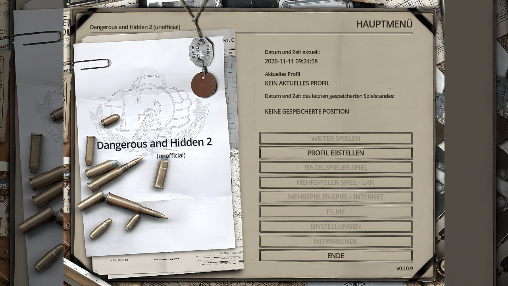
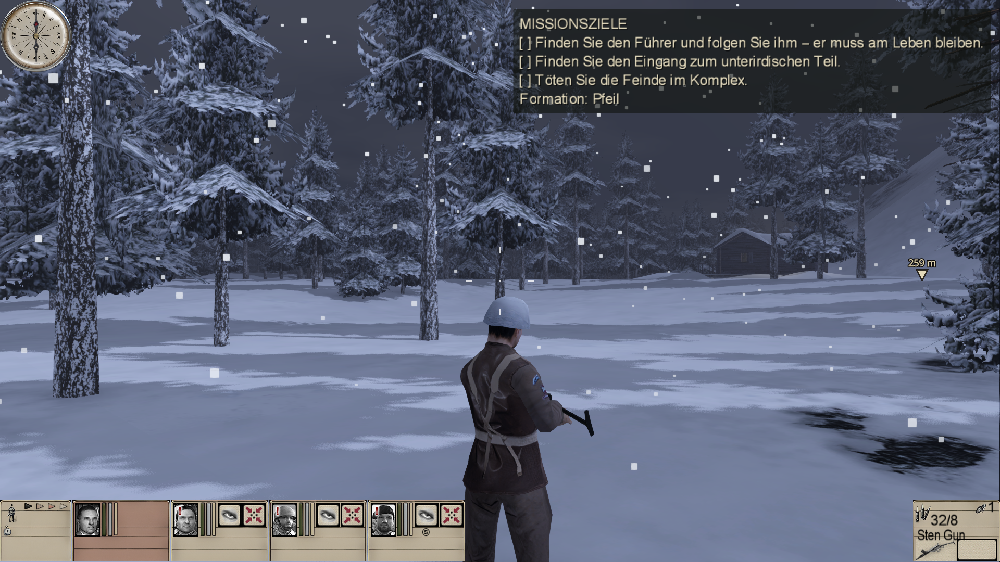
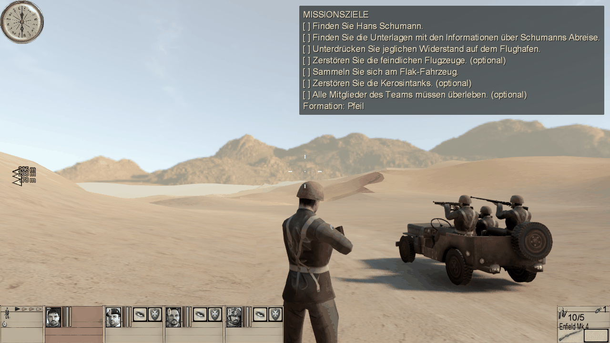
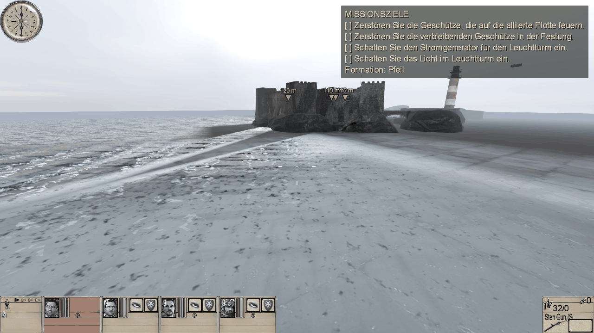
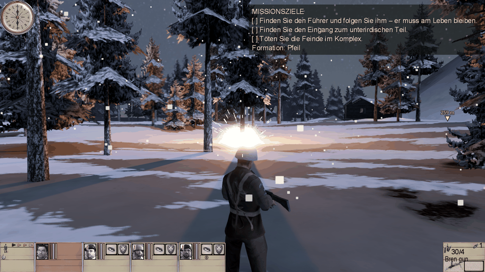
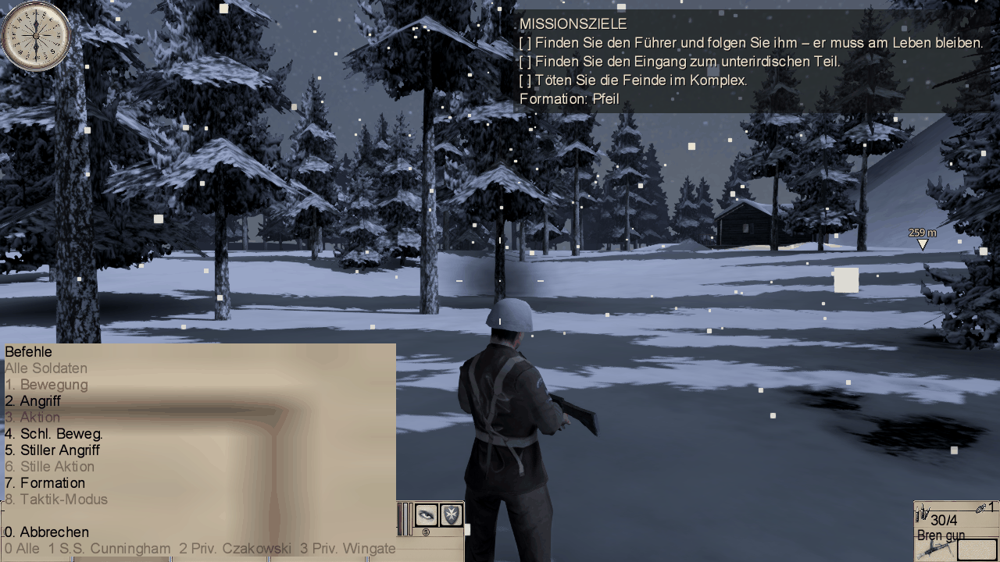
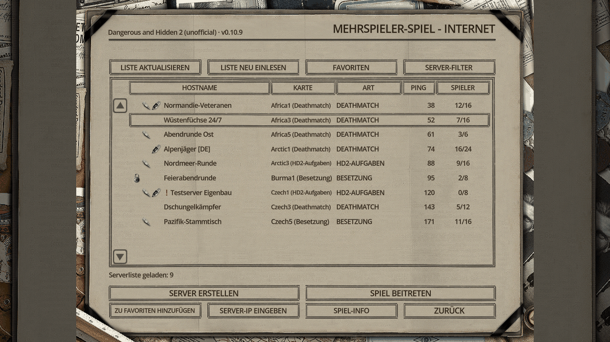

# Dangerous and Hidden 2

🇩🇪 [Deutsch](#deutsch) · 🇬🇧 [English](#english)

---

<a id="deutsch"></a>
# 🇩🇪 Deutsch

**Ein Fanprojekt mit dem Versuch, das großartige alte *Hidden & Dangerous 2* in einer modernen Engine neu umzusetzen.**

Kein offizielles Spiel des Herstellers, keine kommerzielle Absicht – einfach nur die Liebe zum Spiel ❤️

> 🛒 **Kauft das Original!** *Hidden & Dangerous 2* gibt es z. B. bei [GOG](https://www.gog.com/) – ohne eine
> eigene Original-Installation funktioniert dieses Projekt auch gar nicht.

**Hinweis: Die Entwicklung fand rein mit dem Original-Spiel (CD) statt, daher nicht mit der Version Hidden & Dangerous 2: Courage Under Fire und auch ohne das Addon Sabre Squadron.**

## Worum geht es?

*Dangerous and Hidden 2* ist eine **Neuentwicklung mit [Godot 4](https://godotengine.org/)** (GDScript) –
ein taktischer WW2-Squad-Shooter, der sich spielerisch sehr eng am originalen *Hidden & Dangerous 2* orientiert:
SAS-Trupp, Kampagnen in Arktis, Nordafrika, Norwegen, Burma, Alpen, Normandie und Tschechien, Schleichen,
Tarnung, Fahrzeuge, Original-Missionsabläufe.

- **Nah am Original:** Leveldesign, Missionsziele, Missionsskripte, Dialoge, Musik und Klänge sollen sich so
  anfühlen wie damals. Die Original-Missionsskripte werden von einem eigenen neuen Compiler/Interpreter ausgeführt.
- **Quality of Life:** wo es dem Spielgefühl hilft, ist die Bedienung moderner (siehe unten).
- **Neu geschrieben:** Engine-Code, KI, Physik, Oberfläche und Werkzeuge sind eigene Entwicklungen.
  Es wird kein Code des Originals verwendet.
- Texturen, Modelle und Klänge stammen aus dem Original und müssen aus der eigenen Installation manuell
  exportiert und importiert werden (siehe unten).

### Kein 100 % Vanilla mehr

Einzelne Texturen, Effekte und Objekte wurden bereits durch neuere ersetzt bzw. ergänzt. Das Spiel ist daher
optisch nicht mehr zu 100 % identisch mit dem Original. Beispiele:

| Ersetzt / ergänzt | Herkunft / Lizenz |
|---|---|
| Wasser je Klimazone (Original-Wasser in den Optionen wählbar) | eigener Shader, Verfahren angelehnt an „Water shader 3D“ von Lesus (CC0), siehe `THIRD_PARTY_LICENSES.txt` |
| Explosionen, Himmel/Wolken, Wolkenschatten, Schneefall, Bluteffekte | eigene, prozedural erzeugte Effekte (Projektlizenz) |
| Himmel (HDRI je Klimazone) | Poly Haven (polyhaven.com), CC0, siehe `docs/SKY_SOURCES.md` |
| Funkantenne der Testkarte | eigenes Modell, für dieses Projekt erstellt (Projektlizenz) |
| Platzhalter-Waffen, die in der Installation fehlen (z. B. Panzerschreck, G43) | eigene Platzhalter-Modelle (Projektlizenz) |
| HD-/4K-Texturen (optional) | lokal per KI aus den eigenen Originaltexturen erzeugt, nicht im Paket |

Spielwerte (Schaden, Reichweiten, Missionsabläufe) bleiben am Original; Fremdquellen stehen in den Credits und in
`THIRD_PARTY_LICENSES.txt`.

### Funktionen im Überblick

- **Kampagnen aller Einsatzgebiete** (Arktis, Nordafrika, Norwegen, Burma, Alpen, Normandie, Tschechien) mit den
  Original-Missionsskripten, Zielen, Zwischensequenzen, Filmen, Nachbesprechung, Orden und Spielständen; dazu
  Einzelmission, Einzelgänger und Blutbad.
- **Gegner-KI näher am Original:** Wahrnehmung (Sicht, Gehör, Licht), Kampfablauf, Flankieren, Alarm und Suche
  nach den Abläufen des Originals; Verbündete und Kameraden mit eigener KI.
- **Befehlsmenü am Ziffernblock** wie im Original (Bewegung, Angriff, Aktion, Formation, Taktik-Modus),
  **leise Befehle** (geduckt schleichen, schallgedämpfte Waffen), taktische Karte mit Wegpunkten.
- **Tarnung** in Feinduniform, **Kameraden heilen** mit dem Erste-Hilfe-Kit, **Soldatenwerte** (Gesundheit, Kraft,
  Ausdauer, Schießen, Tarnung, Erste Hilfe, Schlösser) wirken im Spiel; SAS-Kader mit Training und Inventar.
- **Grafik:** Grafikstufen von Niedrig bis „4K Ultra“, neues Wasser je Klimazone (Original-Wasser wählbar), moderne
  Explosionen, Himmel und Wolken, wählbare Sichtweite; optional KI-hochskalierte HD-/4K-Texturen.
- **Ragdoll-Physik** und mehrstufige **Blut-Optionen** (aus bis „Extra Gore“), jeweils abschaltbar.
- **Mehrspieler im LAN und Internet:** Deathmatch, Team-Deathmatch, Besetzung, HD2-Aufgaben und **Koop**
  (Einzelspieler-Missionen 1:1 mit mehreren Spielern), KI-Soldaten (Bots), Chat und Sprachchat.
  Internet: **Serverbrowser** über einen Masterserver und **Ranglisten (online)**. Ist der Masterserver nicht
  erreichbar, zeigt das Spiel einen Hinweis; **Beitritt per IP**, Favoriten und LAN funktionieren trotzdem.
- **Dedizierter Server** mit eigenem Konfigurations-Launcher (nach dem Vorbild des Original-ServerLaunchers).
- **Testkarte „Bavaria (Test)“**: eigener Kartenentwurf für Mehrspieler und als Übungseinsatz.
- **Sprachen:** Deutsch, Englisch, Französisch, Italienisch, Spanisch, Tschechisch (Originaltexte der jeweiligen
  Installation; Sprachaufnahmen nur deutsch).

### Datenschutz (Internet-Mehrspieler)

Beim ersten Aufruf des Internet-Mehrspielers erscheint ein Hinweis zur Datenübertragung an den Masterserver:
übertragen werden gehashte und verschlüsselte PC-Daten, der Profilname und gehashte IP-Adressen – ausschließlich für
Sicherheit und den Serverbrowser. Ohne Zustimmung bleibt der Internet-Teil gesperrt; LAN und Einzelspieler sind davon
nicht betroffen.

### Masterserver und Rangliste

Die Internet-Serverliste und die Rangliste laufen über einen Masterserver des Projekts. Gewertet werden nur Spiele auf
verifizierten Servern mit einem offiziellen Build; Bots zählen nicht. Die **RANGLISTE** im Internet-Menü zeigt
Dienstgrad, XP und Statistik, das eigene Konto ist hervorgehoben. Selbst gebaute Clients und Editor-Starts spielen
ohne Wertung. Ist der Masterserver nicht erreichbar, funktionieren Beitritt per IP, Favoriten und LAN weiter.

### Linux

Offizielles Paket `DangerousHidden2_vX.Y.Z_linux_public.tar.gz` (x86_64, gleicher Spielstand und Masterserver-Zugang
wie Windows). Entpacken, `./DangerousHidden2.sh` starten (bei Bedarf `chmod +x DangerousHidden2.x86_64 *.sh`).
Voraussetzung: 64-Bit-Linux mit Vulkan-Treiber. Programm, `.pck` und `version.txt` immer gemeinsam ersetzen.
Originaldaten: Das Werkzeugmenü läuft derzeit nur unter Windows – `orig_cache` auf einem Windows-PC/einer Windows-VM mit
eigener Hidden-&-Dangerous-2-Installation erzeugen und den Ordner neben `DangerousHidden2.x86_64` kopieren. Dedizierter
Server: `./DedicatedServer.sh`; UDP 11001, 11002, 27101 freigeben. Der Linux-Build ist neu und unter Linux noch wenig erprobt.

## Screenshots (v0.11)

| Hauptmenü / Main menu | Einsatz Arktis / Arctic mission |
|---|---|
|  |  |
| **Einsatz Nordafrika / North Africa** | **Normandie mit neuem Wasser / Normandy, new water** |
|  |  |
| **Gefecht: Explosion / Explosion** | **HUD mit Befehlsmenü / HUD with command menu** |
|  |  |
| **Mehrspieler / Multiplayer** | |
|  | |

## Keine Originaldaten im Repository

Dieses Repository enthält **keine Dateien des Originalspiels** – keine Modelle, Texturen, Klänge, Texte oder
Skripte. Wie bei anderen Engine-Nachbauten werden die Daten **aus der eigenen, legal erworbenen
Installation** lokal in einen Cache konvertiert (`orig_cache/`).

*Hidden & Dangerous* und alle zugehörigen Namen, Marken und Inhalte gehören ihren jeweiligen Rechteinhabern.
Dieses Projekt steht in keiner Verbindung zu ihnen und wird von ihnen weder unterstützt noch geprüft.

## Quality of Life gegenüber dem Original

- Moderne Steuerung: Laufschritt als Standard, Shift = Sprint, Leertaste springt bzw. klettert automatisch
  auf Hindernisse und über Zäune/Mauern
- Waffen-/Ausrüstungswahl per Mausrad-Liste, Granate sofort mit G, heilen/Medikit mit H, frei umbelegbare Tasten
- Scharfe Oberfläche in jeder Auflösung und jedem Seitenverhältnis (bis 4K/5K, 21:9)
- Vereinfachtes Inventar (Taschen + Rucksack als ein gemeinsamer Bereich)
- Taktische Karte mit Einzelbefehlen (pausiert das Spiel)
- Leitern, Türen, Schalter und Sprengplätze per Benutzen-Taste; Schutz vor Sackgassen, wenn ein benötigter
  Gegenstand fehlt
- Optional KI-hochskalierte HD-Texturen (aus den eigenen Originaltexturen erzeugt)

## Voraussetzungen

- [Godot 4.7.1](https://godotengine.org/) (Standard-Version, kein .NET nötig)
- Eine Installation von *Hidden & Dangerous 2* (z. B. von GOG)
- Python 3 mit Pillow, numpy, pefile und capstone für die Konvertierung (Skripte in `pipeline/`)

## Installation / Spieldaten exportieren / Texturen hochskalieren

Für Spieler gibt es ein einfaches Konsolen-Menü – keine Programmierkenntnisse nötig:

1. Paket entpacken bzw. Repository herunterladen und **`HD2-Werkzeuge.cmd` doppelklicken**. Das Paket enthält
   `DangerousHidden2.exe` **und** `DangerousHidden2.pck` (Spieldaten) sowie `version.txt`; alle drei gehören
   zusammen und müssen im selben Ordner liegen. Bei einem Update alle drei gemeinsam ersetzen (`orig_cache\`
   bleibt). Passt die `.pck` nicht zur EXE, meldet das Spiel beim Start einen Versionskonflikt.
2. **1) Original-Installation suchen** – findet *Hidden & Dangerous 2* über Registry, GOG, Steam oder übliche
   Ordner; alternativ den Ordner mit `hd2.exe` selbst eingeben. Die Installation wird nur gelesen, nie verändert.
3. **2) Werkzeuge einrichten** – legt eine eigene Python-Umgebung im Ordner `werkzeuge\` neben dem Spiel an
   (nichts wird ohne Rückfrage systemweit installiert) und auf Wunsch ffmpeg für die Filme.
4. **3) Spieldaten exportieren** – Missionen, Mehrspielerkarten, Figuren, Waffen, Klänge, Musik, Menüs, HUD,
   Texte, Originalschriften und Animationen landen in `orig_cache\`. Dauert je nach PC etwa 30–90 Minuten, ist
   jederzeit abbrechbar und setzt beim nächsten Start fort; gescheiterte Einzelschritte werden dabei wiederholt
   (`-Probelauf` listet die offenen Schritte). Jede Sprachfassung (Deutsch, Englisch, Französisch, Italienisch,
   Spanisch, Tschechisch) wird unterstützt; Steam-/GOG-Fassungen des Grundspiels ebenso. Wird die Erweiterung
   *Courage Under Fire / Sabre Squadron* am Inhalt erkannt, erscheint ein Hinweis. Protokolle stehen in
   `werkzeuge\protokolle\`. Wer die Werkzeuge vor diesem Stand eingerichtet hat: Menüpunkt 2 erneut ausführen
   (neues Paket `capstone` für die Schriften).
5. **4) Filme konvertieren** (optional, benötigt ffmpeg).
6. **5) Texturen hochskalieren** (optional) – KI-Hochskalierung auf HD bzw. 4K. Lädt nach Rückfrage PyTorch
   und die Real-ESRGAN-Modelle; auf der CPU dauert das viele Stunden, mit NVIDIA-GPU deutlich weniger.
   Fortsetzbar; das Spiel nutzt die hochskalierten Texturen automatisch.
7. **6) Status** zeigt, was vorhanden ist und was fehlt; **7) Spiel starten**.

Alle Schritte gehen auch ohne Menü, z. B.
`powershell -ExecutionPolicy Bypass -File tools\user\hd2_menu.ps1 -Aktion Export -Orig "C:\Spiele\Hidden & Dangerous 2"`.
Die erzeugten Daten stammen aus dem eigenen Spiel und dürfen nicht weitergegeben werden.

> 💡 **Nur einmal exportieren:** Die einmal exportierten bzw. hochskalierten Originaldaten (`orig_cache\`) und die
> eingerichteten Werkzeuge (`werkzeuge\`) können bei **jedem neuen Release weiterverwendet** werden. Für ein Update
> nur `DangerousHidden2.exe`, `DangerousHidden2.pck` und `version.txt` ersetzen bzw. das neue Paket in denselben
> Ordner entpacken. Nur wenn die Versionshinweise ausdrücklich einen neuen Export verlangen, Menüpunkt 3 erneut
> ausführen – bereits erledigte Schritte werden dabei übersprungen.

## Schnellstart

1. **Originaldaten konvertieren** (einmalig, aus der eigenen Installation):
   ```
   python -I pipeline/convert_mission.py ARCTIC1
   ```
   bzw. alle Missionen mit `tools/convert_all.ps1`. Die Pfade zur Original-Installation stehen am Anfang der
   Skripte.
2. **Spielen:**
   ```
   tools\godot.cmd -- --mission=a1_blizzard
   ```
   oder einfach `tools\godot.cmd` für das Hauptmenü.
3. **Tests:** `powershell -File tools\run_tests.ps1` (headless, alle Suiten)

## Stand

In aktiver Entwicklung (Version 0.11.x). Alle Kampagnen sind mit Originaldaten spielbar und werden
laufend mit dem Original abgeglichen; vollständig fehlerfrei ist noch keine davon.
- **Es gibt noch diverse Fehler**, z. B. hängende oder unpassend reagierende KI, Abweichungen in einzelnen
  Missionsabläufen, Darstellungsfehler und Performance-Einbrüche auf großen Karten.
- Werte, die im Original nicht entschlüsselt sind, sind geschätzt und im Code gekennzeichnet.
- Der Mehrspieler (besonders Internet, Koop und Ranglisten) ist noch wenig im Praxiseinsatz erprobt.
- Rückmeldungen und Fehlerberichte bitte über die GitHub Issues.

## Steuerung (Standard)

WASD bewegen · Shift sprinten · C hocken · Z/Y liegen · Leertaste springen/klettern · Q/E lehnen ·
LMT feuern · RMT zielen · R nachladen · Mausrad Ausrüstungswahl (oder 1-9) · G Granate · F benutzen ·
V 1./3. Person · F1–F4 Soldat wählen · M taktische Karte · F5/F9 Schnellspeichern/-laden · Esc Pause
· Befehlsmenü: Num 0 = Befehl an alle, Num 1–6 = einzelner Kamerad (der aktive Soldat wird übersprungen)

Weitere Tasten wie im Original: P Pause · I Inventar · Rücktaste Gegenstand fallen lassen · B Fernglas · ' Aktionsmenü ·
Komma bzw. O Missionsziele · Alt Handbremse · H Erste Hilfe · MMT Feuermodus · X/U/J/K/L/N/T Direktbefehle.
Auf der taktischen Karte gelten die Original-Taktiktasten (G sammeln, V/B Signal, Q/E stehen/liegen, F/C/X/Z,
Rücktaste/Entf löschen, Pfeiltasten verschieben, Ziffernblock +/− zoomen). Alle Aktionen des Originals stehen im
Optionsmenü (Tastenbelegung) und lassen sich umbelegen; einige sind ab Werk frei, z. B. Gangart schneller/langsamer
(Gehen/Schleichen), Springen und Klettern getrennt sowie Interface-Modus.

*Gemacht von Fans für Fans. Wenn euch das gefällt: Kauft das Original und spielt es – es lohnt sich bis heute.*

---

<a id="english"></a>
# 🇬🇧 English

**A fan project attempting to rebuild the great old *Hidden & Dangerous 2* in a modern engine.**

Not an official game by the publisher, no commercial intent – just love for the game ❤️

> 🛒 **Buy the original!** *Hidden & Dangerous 2* is available e.g. on [GOG](https://www.gog.com/) – this project
> does not work without your own original installation.

**Note: Development was done solely with the original game (CD), i.e. not with Hidden & Dangerous 2: Courage Under Fire and without the Sabre Squadron add-on.**

## What is it?

*Dangerous and Hidden 2* is a **new implementation in [Godot 4](https://godotengine.org/)** (GDScript) – a tactical
WW2 squad shooter that follows the original *Hidden & Dangerous 2* very closely: SAS squad, campaigns in the Arctic,
North Africa, Norway, Burma, the Alps, Normandy and Czechoslovakia, stealth, disguise, vehicles and the original
mission flow.

- **Close to the original:** level design, objectives, mission scripts, dialogue, music and sound are meant to feel
  like back then. The original mission scripts run on a newly written compiler/interpreter.
- **Quality of life:** where it helps the gameplay, controls are more modern (see below).
- **Newly written:** engine code, AI, physics, UI and tools are our own work. No code from the original is used.
- Textures, models and sounds come from the original and must be exported from your own installation (see below).

### No longer 100 % vanilla

Some textures, effects and objects have already been replaced or extended with newer ones, so the game no longer looks
100 % identical to the original. Examples:

| Replaced / added | Source / licence |
|---|---|
| Water per climate zone (original water selectable in the options) | own shader, technique based on "Water shader 3D" by Lesus (CC0), see `THIRD_PARTY_LICENSES.txt` |
| Explosions, sky/clouds, cloud shadows, snowfall, blood effects | own procedurally generated effects (project licence) |
| Sky (HDRI per climate zone) | Poly Haven (polyhaven.com), CC0, see `docs/SKY_SOURCES.md` |
| Radio antenna of the test map | own model made for this project (project licence) |
| Placeholder weapons missing from the installation (e.g. Panzerschreck, G43) | own placeholder models (project licence) |
| HD/4K textures (optional) | generated locally by AI from your own original textures, not in the package |

Gameplay values (damage, ranges, mission flow) stay with the original; third-party sources are listed in the credits
and in `THIRD_PARTY_LICENSES.txt`.

### Features at a glance

- **Campaigns of all theatres** (Arctic, North Africa, Norway, Burma, Alps, Normandy, Czechoslovakia) with the
  original mission scripts, objectives, cutscenes, movies, debriefing, medals and save games; plus single mission,
  lone wolf and carnage.
- **Enemy AI closer to the original:** perception (sight, hearing, light), combat flow, flanking, alarm and search
  following the original's logic; allies and squad mates with their own AI.
- **Numpad command menu** as in the original (move, attack, action, formation, tactical mode), **silent orders**
  (crouched sneaking, silenced weapons), tactical map with waypoints.
- **Disguise** in enemy uniform, **heal comrades** with the first-aid kit, **soldier stats** (health, strength,
  stamina, shooting, camouflage, first aid, lock picking) have an effect; SAS roster with training and inventory.
- **Graphics:** quality levels from Low to "4K Ultra", new water per climate zone (original water selectable),
  modern explosions, sky and clouds, selectable view distance; optional AI-upscaled HD/4K textures.
- **Ragdoll physics** and multi-level **blood options** (off up to "Extra Gore"), each can be turned off.
- **Multiplayer over LAN and internet:** deathmatch, team deathmatch, occupation, HD2 objectives and **co-op**
  (single-player missions 1:1 with several players), AI soldiers (bots), text and voice chat.
  Internet: **server browser** via a master server and **online rankings**. If the master server cannot be reached,
  the game shows a notice; **joining by IP**, favourites and LAN still work.
- **Dedicated server** with its own configuration launcher (modelled on the original ServerLauncher).
- **Test map "Bavaria (Test)"**: our own map design for multiplayer and as a practice mission.
- **Languages:** German, English, French, Italian, Spanish, Czech (original texts of the respective installation;
  voice recordings German only).

### Privacy (internet multiplayer)

When you open internet multiplayer for the first time, a notice about data sent to the master server is shown:
hashed and encrypted PC data, the profile name and hashed IP addresses are transmitted – solely for security and the
server browser. Without consent the internet part stays locked; LAN and single player are not affected.

### Master server and leaderboard

The internet server list and the leaderboard run on a master server of the project. Only matches on verified servers
with an official build are rated; bots do not count. The **LEADERBOARD** in the internet menu shows rank, XP and
statistics, with your own account highlighted. Self-built clients and editor starts play unrated. If the master server
cannot be reached, joining by IP, favourites and LAN still work.

### Linux

Official package `DangerousHidden2_vX.Y.Z_linux_public.tar.gz` (x86_64, same game and master-server access as Windows).
Extract and run `./DangerousHidden2.sh` (if needed `chmod +x DangerousHidden2.x86_64 *.sh`). Requires 64-bit Linux with a
Vulkan driver. Always replace program, `.pck` and `version.txt` together. Original data: the tools menu currently runs on
Windows only – create `orig_cache` on a Windows PC/VM with your own Hidden & Dangerous 2 installation and copy the folder
next to `DangerousHidden2.x86_64`. Dedicated server: `./DedicatedServer.sh`; open UDP 11001, 11002, 27101. The Linux build
is new and has seen little testing on Linux so far.

## Screenshots (v0.11)

See the table in the German section above (captions in both languages).

## No original data in the repository

This repository contains **no files of the original game** – no models, textures, sounds, texts or scripts. As with
other engine recreations, the data is converted locally **from your own, legally purchased installation** into a
cache (`orig_cache/`).

*Hidden & Dangerous* and all related names, trademarks and content belong to their respective rights holders. This
project is not affiliated with, endorsed or reviewed by them.

## Quality of life compared to the original

- Modern controls: jogging by default, Shift = sprint, Space jumps or automatically climbs obstacles, fences and walls
- Weapon/equipment selection via a mouse-wheel list, instant grenade with G, heal/medkit with H, fully rebindable keys
- Sharp UI in every resolution and aspect ratio (up to 4K/5K, 21:9)
- Simplified inventory (pockets + backpack as one shared area)
- Tactical map with individual orders (pauses the game)
- Ladders, doors, switches and demolition spots via the use key; protection against dead ends if a required item is
  missing
- Optional AI-upscaled HD textures (generated from your own original textures)

## Requirements

- [Godot 4.7.1](https://godotengine.org/) (standard version, no .NET required)
- An installation of *Hidden & Dangerous 2* (e.g. from GOG)
- Python 3 with Pillow, numpy, pefile and capstone for the conversion (scripts in `pipeline/`)

## Installation / exporting game data / upscaling textures

For players there is a simple console menu – no programming knowledge needed:

1. Unpack the package or download the repository and **double-click `HD2-Werkzeuge.cmd`**. The package contains
   `DangerousHidden2.exe` **and** `DangerousHidden2.pck` (game data) plus `version.txt`; all three belong together and
   must be in the same folder. When updating, replace all three together (`orig_cache\` stays). If the `.pck` does not
   match the EXE, the game reports a version conflict at start.
2. **1) Find original installation** – locates *Hidden & Dangerous 2* via registry, GOG, Steam or common folders;
   alternatively enter the folder containing `hd2.exe`. The installation is only read, never changed.
3. **2) Set up tools** – creates a separate Python environment in `werkzeuge\` next to the game (nothing is installed
   system-wide without asking) and optionally ffmpeg for the movies.
4. **3) Export game data** – missions, multiplayer maps, characters, weapons, sounds, music, menus, HUD, texts,
   original fonts and animations end up in `orig_cache\`. Takes about 30–90 minutes depending on the PC, can be
   cancelled at any time and resumes on the next start; failed steps are retried (`-Probelauf` lists open steps).
   Every language version (German, English, French, Italian, Spanish, Czech) is supported, as are the Steam/GOG
   versions of the base game. If the *Courage Under Fire / Sabre Squadron* expansion is detected, a notice is shown.
   Logs are in `werkzeuge\protokolle\`. If you set up the tools before this version, run menu item 2 again (new
   package `capstone` for the fonts).
5. **4) Convert movies** (optional, requires ffmpeg).
6. **5) Upscale textures** (optional) – AI upscaling to HD or 4K. Downloads PyTorch and the Real-ESRGAN models after
   asking; on the CPU this takes many hours, much less with an NVIDIA GPU. Resumable; the game uses the upscaled
   textures automatically.
7. **6) Status** shows what is present and what is missing; **7) Start game**.

All steps also work without the menu, e.g.
`powershell -ExecutionPolicy Bypass -File tools\user\hd2_menu.ps1 -Aktion Export -Orig "C:\Games\Hidden & Dangerous 2"`.
The generated data comes from your own game and must not be redistributed.

> 💡 **Export only once:** once exported and/or upscaled, the original data (`orig_cache\`) and the installed tools
> (`werkzeuge\`) can be **reused with every new release**. To update, just replace `DangerousHidden2.exe`,
> `DangerousHidden2.pck` and `version.txt`, or unpack the new package into the same folder. Only run menu item 3
> again if the release notes explicitly ask for a new export – steps already done are skipped.

## Quick start

1. **Convert original data** (once, from your own installation):
   ```
   python -I pipeline/convert_mission.py ARCTIC1
   ```
   or all missions with `tools/convert_all.ps1`. The paths to the original installation are at the top of the scripts.
2. **Play:**
   ```
   tools\godot.cmd -- --mission=a1_blizzard
   ```
   or simply `tools\godot.cmd` for the main menu.
3. **Tests:** `powershell -File tools\run_tests.ps1` (headless, all suites)

## Status

In active development (version 0.11.x). All campaigns are playable with original data and are continuously compared
with the original; none of them is completely bug-free yet.
- **There are still various bugs**, e.g. stuck or oddly reacting AI, deviations in individual mission flows, display
  errors and performance drops on large maps.
- Values not decoded from the original are estimated and marked in the code.
- Multiplayer (especially internet, co-op and rankings) has seen little real-world use so far.
- Please send feedback and bug reports via GitHub Issues.

## Controls (default)

WASD move · Shift sprint · C crouch · Z/Y prone · Space jump/climb · Q/E lean ·
LMB fire · RMB aim · R reload · mouse wheel equipment selection (or 1-9) · G grenade · F use ·
V 1st/3rd person · F1–F4 select soldier · M tactical map · F5/F9 quick save/load · Esc pause
· Command menu: Num 0 = order to all, Num 1–6 = single squad mate (the active soldier is skipped)

More keys as in the original: P pause · I inventory · Backspace drop item · B binoculars · ' action menu ·
comma or O objectives · Alt handbrake · H first aid · MMB fire mode · X/U/J/K/L/N/T direct orders.
On the tactical map the original tactical keys apply (G gather, V/B signal, Q/E stand/prone, F/C/X/Z,
Backspace/Del delete, arrow keys pan, numpad +/− zoom). All actions of the original are in the options menu (key
bindings) and can be rebound; some are unbound by default, e.g. gait faster/slower (walk/sneak), separate jump and
climb, and interface mode.

*Made by fans for fans. If you like it: buy the original and play it – it is still worth it today.*

---

## Danksagung / Acknowledgements

**Credits:** Godot Engine (MIT) · Sky HDRIs: Poly Haven (polyhaven.com), CC0 · Wassershader-Verfahren nach „Water shader 3D“ von Lesus (CC0) · RellHaiser
(siehe unten). Vollständige Liste / full list: `THIRD_PARTY_LICENSES.txt`.

Dank an **RellHaiser** für das Projekt [HD2_SabreSquadron](https://github.com/RellHaiser/HD2_SabreSquadron), einen
C++-Nachbau des Spiel-Clients von Hidden & Dangerous 2: Sabre Squadron. Seine Dokumentation und Adressangaben haben uns
geholfen, Abläufe im Original zu finden; die übernommenen Erkenntnisse wurden, soweit möglich, gegen das Original geprüft
und eigenständig umgesetzt. Es wurde kein Code übernommen.

Thanks to **RellHaiser** for [HD2_SabreSquadron](https://github.com/RellHaiser/HD2_SabreSquadron), a C++ reconstruction of
the Hidden & Dangerous 2: Sabre Squadron game client. Its documentation and address notes helped us locate behaviour in the
original; the findings we used were checked against the original wherever possible and implemented independently. No code
was copied.

## KI-Disclaimer / AI Development Disclosure

Dieses Projekt entsteht unter wesentlicher Unterstützung durch generative KI und KI-gestützte Entwicklungswerkzeuge.
KI-Systeme werden unter anderem für folgende Aufgaben eingesetzt:
Erstellung, Überarbeitung und Optimierung von Quellcode
Entwicklung und Implementierung von Spielmechaniken, Benutzeroberflächen und KI-Verhalten
Analyse und Rekonstruktion von Dateiformaten, technischen Abläufen und Spielmechaniken
Fehlersuche, Debugging, Refactoring und automatisierte Tests
Erstellung und Pflege technischer Dokumentationen
Unterstützung bei der Modernisierung und optionalen Hochskalierung grafischer Ressourcen
Wichtige Hinweise:
KI-generierter oder KI-unterstützter Code kann Fehler, Sicherheitslücken, unvollständige Implementierungen und unerwartetes Verhalten enthalten.
Die Verwendung von KI bedeutet nicht, dass sämtliche Implementierungen vollständig getestet oder fehlerfrei sind.
KI-generierte Ergebnisse werden im Rahmen der Entwicklung überprüft und angepasst. Eine vollständige manuelle Prüfung jeder Codezeile kann jedoch nicht garantiert werden.
Die technische und kreative Ausrichtung des Projekts sowie Entscheidungen über die Integration von Änderungen liegen bei der Projektleitung.
Die Nutzung von KI begründet keine Verbindung zu den Entwicklern, Publishern oder Rechteinhabern des Originalspiels.

This project is developed with substantial assistance from generative AI tools. AI is used for coding, debugging, reverse engineering, documentation, gameplay implementation, and asset-processing workflows.
AI-assisted contributions may contain bugs, inaccuracies, security vulnerabilities, or incomplete features. Not all generated code or content is guaranteed to have undergone comprehensive manual review or testing.
The project remains an independent, unofficial fan-made recreation and is not affiliated with or endorsed by the original game's developers, publishers, or rights holders.

## Rechteinhaber / Takedown Requests

Dieses Projekt ist ein unabhängiges, nicht kommerzielles Fanprojekt und verfolgt nicht die Absicht, Urheberrechte, Markenrechte oder sonstige Rechte Dritter zu verletzen.

**Sollten Rechteinhaber Bedenken hinsichtlich bestimmter Inhalte oder des Projekts haben, bitten wir um direkte Kontaktaufnahme über die GitHub Issues oder die Kontaktmöglichkeiten des Repository-Inhabers.**

Berechtigte Anfragen werden ernst genommen und zeitnah geprüft. Betroffene Inhalte können bei Bedarf angepasst oder entfernt werden. Falls erforderlich, kann auch die Veröffentlichung des gesamten Projekts eingestellt werden.

### Rights Holders / Takedown Requests

This is an independent, non-commercial fan project and is not intended to infringe upon any copyrights, trademarks, or other intellectual property rights.

**If you are a rights holder and have concerns regarding any content or the project itself, please contact us directly through GitHub Issues or the repository owner's contact information.**

Legitimate requests will be reviewed promptly. Relevant content may be modified or removed, and distribution of the entire project may be discontinued if necessary.
